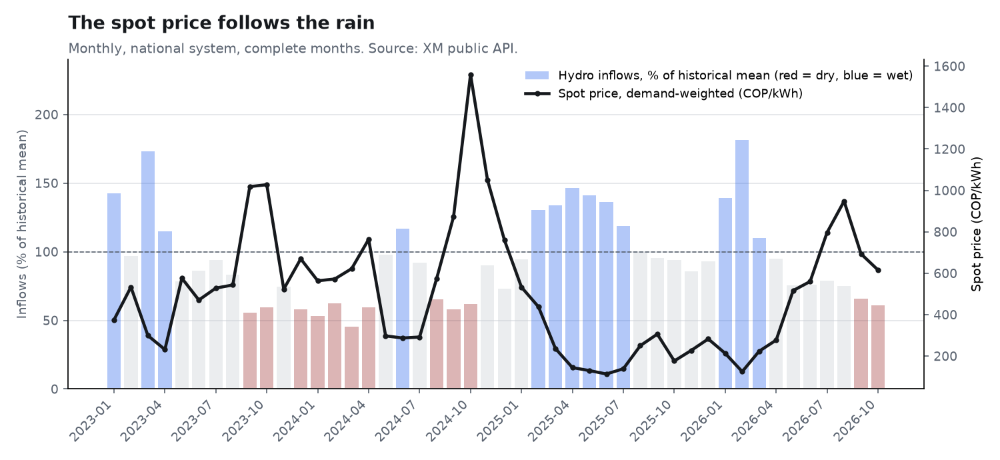
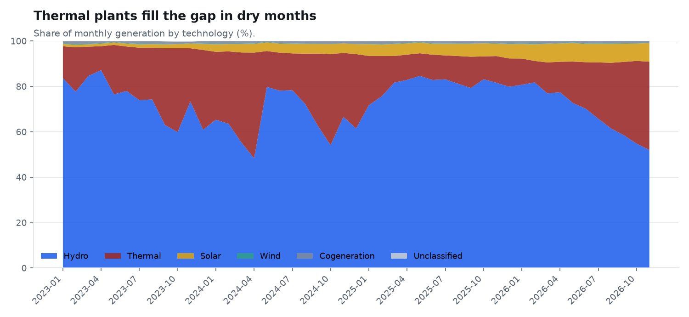
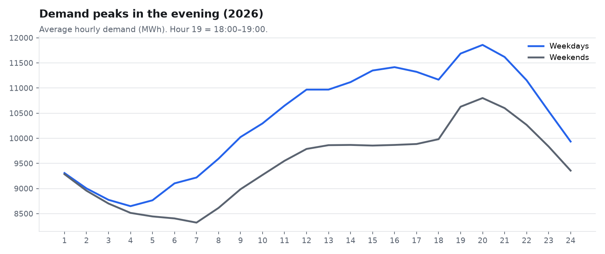
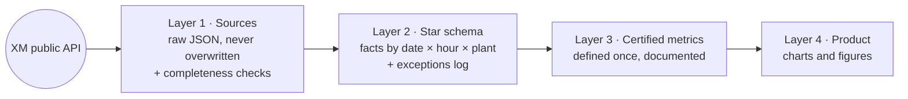

# Colombia Energy Analytics

**What drives the price of electricity in Colombia?** An end-to-end analytics engineering project on public data from
[XM](https://www.xm.com.co/), the operator of Colombia's power market: 11 million hourly records from January 2023 to
November 2026, modeled with dbt and tested at every layer.



---

## Decision memo

**Question.** A company that buys electricity on the spot market (an industrial plant, a retailer) wants to know when
prices will rise, so it can decide when to lock in a fixed-price contract.

**Finding 1 — The spot price follows the rain, not the reservoirs.**
Hydro plants produced 72 % of Colombia's electricity in this period. Over 46 complete months, the monthly spot price moved with **hydro inflows**
(correlation **−0.68**) far more than with **reservoir level** (−0.18).

| Hydro inflows vs. historical mean | Months | Median spot price |
|---|---:|---:|
| Dry (below 70 %) | 12 | **681 COP/kWh** |
| Below normal (70–100 %) | 21 | 523 COP/kWh |
| Wet (100 % or more) | 13 | **224 COP/kWh** |

In dry months the median price was about **3 times** the wet-month price. The highest monthly price, **1,560 COP/kWh in
October 2024**, came with inflows at 62 % of normal while reservoirs were still 55 % full. The lowest reservoir level,
**31.5 % in March 2024**, did not produce the highest price.

**Finding 2 — Thermal plants fill the gap, and they set the price.**
The share of thermal generation and the spot price move together (correlation **+0.85**). Thermal plants peaked at
**46.6 % of generation in April 2024**, during the El Niño dry period, and stayed at 10–14 % for most of the wet year of 2025.



**Finding 3 — 2026 is drying again.** Since May 2026 inflows have stayed below normal (61–79 %), thermal generation
climbed back to 36 % in October, and the price rose to 948 COP/kWh in August, even with reservoirs near 77 %.

**Recommendation.** Track *inflows as a share of the historical mean* as an early-warning indicator. When it drops below
70 %, a spot-exposed buyer should expect prices around three times higher than in a wet month and review its contracting
strategy. Reservoir level alone is a weak signal.

**Evidence.** Every figure above comes from the certified metrics in [`dbt/models/metrics`](dbt/models/metrics) and is
regenerated by [`app/build_report.py`](app/build_report.py) into [`docs/key_figures.json`](docs/key_figures.json).
Correlation is not causation: this is a monthly, descriptive analysis, not a price forecast.

### Also in the data
- **Demand keeps growing:** 81,214 GWh in 2023 → 83,308 GWh in 2024 (+2.6 %) → 84,605 GWh in 2025 (+1.6 %).
- **The daily peak is at 19:00–20:00**, about 37 % above the early-morning low on weekdays (2026).



---

## How it is built



| Layer | What it does | Where |
|---|---|---|
| **1 · Sources** | Calls the XM API month by month, saves each response untouched with its load timestamp, rejects any month with a missing day or hour, and logs every load in a control manifest | [`etl/`](etl) |
| **2 · Model** | Star schema in dbt: `fct_system_hourly` (date × hour), `fct_generation_by_resource_hourly` (date × hour × plant), `fct_hydrology_daily`, `dim_date`, `dim_resource` | [`dbt/models/core`](dbt/models/core) |
| **3 · Metrics** | Demand-weighted spot price, inflows vs. historical, reservoir level, generation mix, hourly profile | [`dbt/models/metrics`](dbt/models/metrics) |
| **4 · Product** | Reads only certified metrics and builds the charts and key figures | [`app/`](app) |

**Data:** 7 XM metrics plus the plant list; 11.1 million plant-level hourly records and 34,000 hourly system records.

### Quality controls (every test can fail)

| Control | Check |
|---|---|
| Completeness | 24 hours per day with demand, price and generation; no missing days |
| Uniqueness | One row per key in every dimension and monthly metric |
| Validity | Demand, price and reservoir level inside physical and market ranges |
| Consistency | Every plant in the facts exists in the plant dimension |
| **Accuracy** | **Plant-level generation reconciles with the system total within 0.5 % every day** |
| Timeliness | Latest data no older than 7 days (warning) |

All 16 dbt data tests and 8 Python tests pass. 14 plants with generation but no attributes in XM's current list (161 GWh,
0.05 % of the total) are kept as `UNCLASSIFIED` and logged in an exceptions table instead of being dropped.

### Governance
- [Data dictionary](docs/data_dictionary.md): one card per metric, with its definition in words and SQL, source and tests.
- [Runbook](docs/runbook.md): how to run it, where the data lives and what to do when something fails.
- [Decision log](docs/decisions.md): why each design choice was made and what else was considered.

## Run it

```bash
python -m venv .venv && source .venv/bin/activate      # Windows: .venv\Scripts\activate
pip install -r requirements.txt
python -m etl.ingest --start 2023-01-01                 # load XM data (first run: several minutes)
dbt build --project-dir dbt --profiles-dir dbt          # build models and run all tests
python -m app.build_report                              # charts and key figures
```

A GitHub Actions workflow refreshes the data weekly and reruns every test; CI runs the offline tests on every push.

**Stack:** Python · DuckDB · dbt · GitHub Actions · matplotlib. No paid services: it runs on a laptop.

---

**Resumen en español.** Proyecto de ingeniería analítica sobre datos públicos de XM (2023–2026). El precio de bolsa sigue
a los aportes hídricos (correlación −0,68), no al nivel de los embalses (−0,18): en meses secos la mediana del precio
fue unas 3 veces la de los meses húmedos. Cuatro capas (fuentes, modelo estrella, métricas certificadas y producto),
16 pruebas de datos y 8 de código y documentación de gobierno.

**Author:** Javier Daza · Production engineer working in data ·
[LinkedIn](https://www.linkedin.com/in/javier-daza-5201b1176/) · [Portfolio](https://javierdataanalyst.github.io/Issues-and-solutions/)

*Data: XM S.A. E.S.P., public API. This project is independent and not affiliated with XM.*
